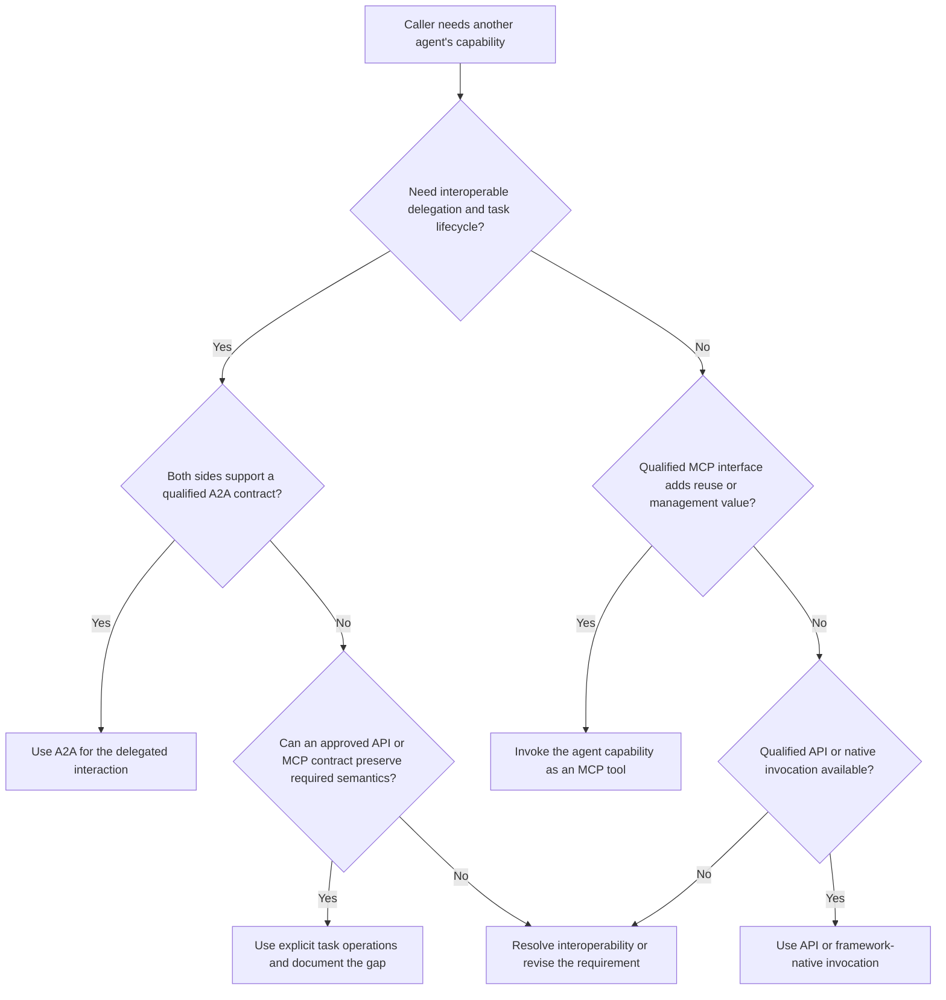

# Agent interaction: API, MCP or A2A?

Use this tree when the capability provider is another agent. For access to applications and data sources, start with the [system access decision tree](decision-tree.md).

The implementation behind an endpoint does not determine its communication protocol. Define what the caller needs from the other agent, then choose a supported interaction contract.

## Qualify the interaction first

Identify the delegated outcome, receiver, authority, permitted data destinations, source freshness, evidence requirements, deadlines and cost limits. Verify that the receiver cannot use broader credentials to expand the caller's authority. Approve downstream tools, delegations and side effects within explicit bounds.

All candidate paths must support required security, governance and service objectives. A2A availability alone does not establish trust or quality.

## Decision tree

A qualified MCP-only offering can provide the management and integration value needed for the MCP branch. For a new interface, compare implementation cost and client requirements before building it.

## Interpret the branches

| Interaction | Candidate | Required contract |
| --- | --- | --- |
| Obtain a bounded answer or classification from a known agent endpoint | API | Explicit inputs, output, evidence, errors, authority and timeout |
| Make that capability available as a tool across compatible consumers | MCP | Curated tool definition and invocation, plus the same business and security contract |
| Delegate work across independently operated agents with shared task semantics | A2A | Supported discovery, messages, task state, artifacts and lifecycle features needed by the use case |
| Invoke an internal subagent within one application | Framework-native call | Explicit context, authority and resource boundaries |
| Use an API or MCP for a required long-running task lifecycle | Explicit task service | Task identifiers, status, clarification, cancellation, result access and retention as required |

A bounded invocation may take a long time or perform sophisticated reasoning. Duration and intelligence alone do not require A2A. An API can implement asynchronous tasks, and MCP implementations can support task-oriented features. A2A is useful when shared agent-interaction semantics reduce custom integration across systems. Verify the actual versions and capabilities rather than assuming every deployment supports every lifecycle feature.

## Examples

- A travel agent asks an expense-policy agent to classify a supplied expense. An existing qualified API may be sufficient.
- Several MCP-compatible assistants need the same bounded policy assessment. An MCP tool may simplify reuse and controlled exposure.
- A travel agent delegates an itinerary investigation to a separately operated planning agent, which requests clarification and returns progress and artifacts. Assess A2A when both sides support the required lifecycle.
- A receiving agent retrieves current bookings through API tools or MCP. Its source integration is a separate decision from the caller-to-agent protocol.

## Security, governance and performance

Treat peer messages and artifacts as untrusted input. Minimize shared context, constrain downstream delegation and preserve source evidence and observation times. A generated answer timestamp does not demonstrate current evidence.

Set time, token, tool-call, concurrency and cost budgets. Prevent cyclic delegation, propagate supported cancellation and reconcile tasks whose completion is uncertain. Compare the receiver's task quality and end-to-end cost with a caller-with-tools baseline where that is a viable alternative.

Delegation does not authorize future writes. Apply [governed-action controls](governed-actions.md) at the point of execution, including when the receiving agent uses additional tools. Record peer identity, owner, approved skills, data boundary, protocol profile and evidence in the [governance process](governance.md).

## Evidence

This tree is project guidance based on the [A2A and MCP comparison](https://a2a-protocol.org/latest/topics/a2a-and-mcp/) and the primary sources in the [research guide](research-and-sources.md). Protocol choice alone guarantees neither safe delegation nor correct results.
