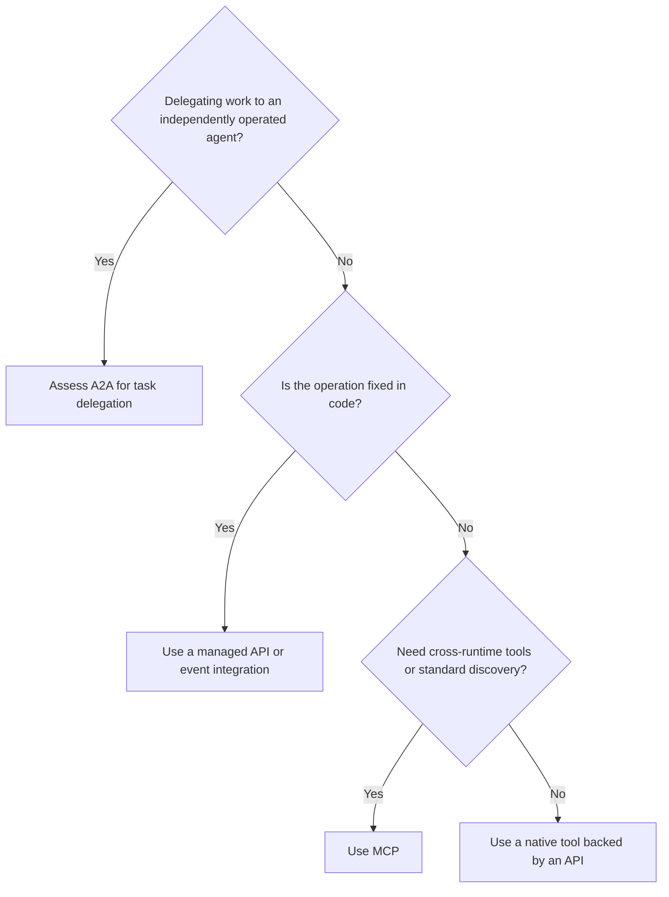
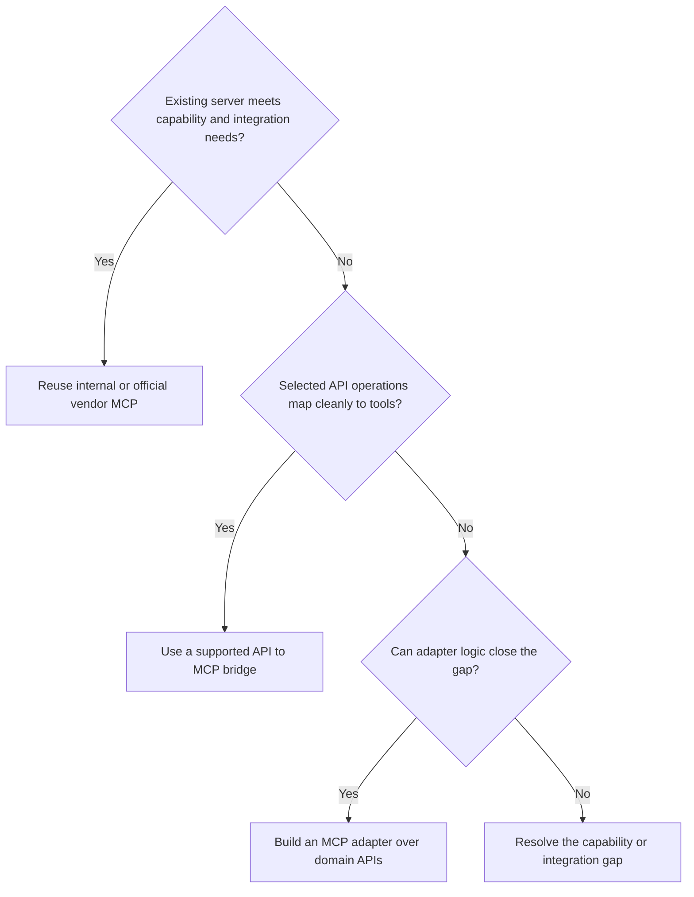

# Choosing MCP APIs and agent delegation

Decide per business capability and caller. An agent can use multiple integration patterns within the same workflow.

## Choose the consumer interface

A2A is useful when the peer owns execution and the interaction benefits from advertised skills, task state or artifacts. A fixed handoff may use an API. The receiving agent can itself call MCP tools.

For a fixed service, UI, batch or agent workflow step, select an API or event contract according to the integration requirements. A model-selected tool confined to one runtime can use that platform's function or native tool interface. MCP becomes useful when standard discovery, client compatibility or shared tool contracts have concrete value.

## Choose how to provide MCP

An existing server fits when its semantics, authentication, data boundary, transport and required controls work with the intended clients and gateway. Hosting is a separate choice between a supported vendor service and an enterprise-operated deployment.

A bridge suits stable operations with suitable input and output contracts. Review generated tools individually. An adapter is appropriate for composition, response shaping or supported credential mediation. Keep authoritative business rules in the domain service.

## Apply the decision

| Situation | Candidate pattern | Decision reason |
| --- | --- | --- |
| A scheduled inventory synchronization | Managed API or events | Execution and data flow are predetermined |
| A single assistant calls a small existing service | Native tool over API | Runtime integration meets the current need |
| Several agent platforms need the same lookup | MCP over managed API | Shared discovery and semantics |
| A SaaS provider offers a suitable official server | Vendor MCP through enterprise gateway | Reuse supported provider integration |
| Several API calls form one bounded business capability | MCP adapter | Shape a coherent operation and result |
| One agent delegates an investigation to another | A2A where supported | Peer owns the task and its artifacts |

For large payloads, bulk processing and long-running work, evaluate job APIs, events and authorized artifact references. MCP can expose submission and status tools while execution runs in the appropriate service.

Protocol choice does not determine whether an action needs human approval. Apply the separate [governed action process](governed-actions.md).

## Evidence

The MCP tools specification defines discovery and invocation. A2A defines interaction with independent agents. Anthropic's engineering guidance motivates task-oriented tool design, while Microsoft's API Management documentation demonstrates selected API operations exposed as MCP tools. The decision branches above are this project's synthesis.

[Sources and product mappings](research-and-sources.md).
