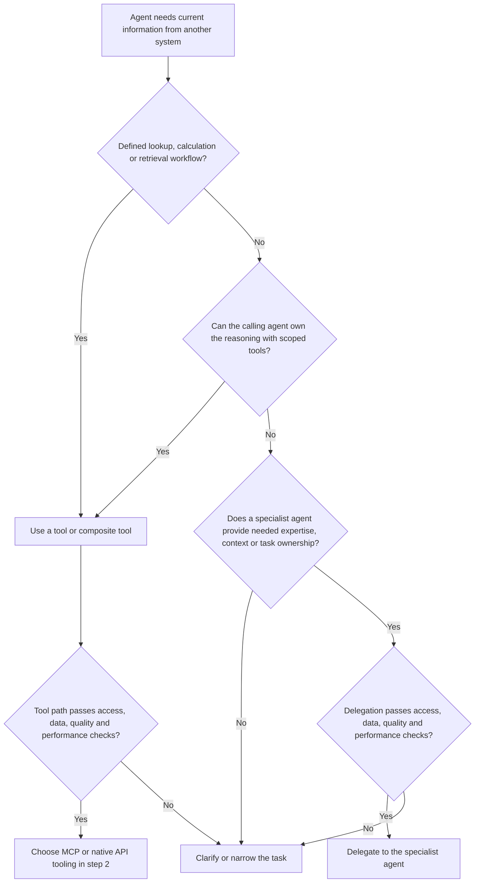
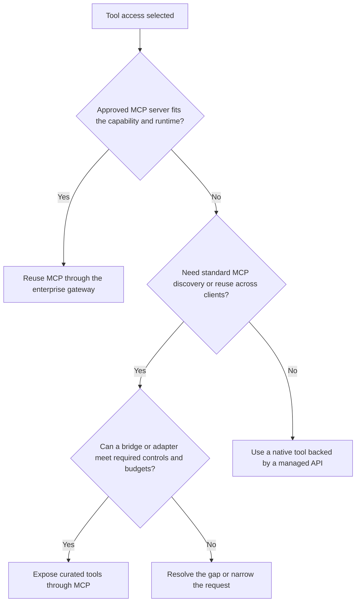

# Choosing tools and agents for current external information

Start with an agent that needs information from a system outside its own runtime. The system may be an internal application, database or service, or a third-party product. Its organizational location does not determine whether to use a tool or delegate to another agent.

The first decision is who should own the information-gathering task and its reasoning. Then choose the interface that carries the interaction.

A tool offers a bounded capability with a defined contract. An MCP server exposes such capabilities through MCP and may call underlying APIs. A specialist agent owns a delegated goal and can choose how to pursue it within its permitted scope. Both patterns can coexist in the same request.

## 1 Choose a tool call or agent delegation

A defined workflow may include several API calls, joins, calculations, filtering or a long-running job. Complexity and duration alone do not require a second agent. The caller can also reason dynamically while choosing among several tools.

Delegation is a candidate when the receiving agent must investigate an ambiguous goal, apply specialized context, choose further evidence based on findings, or own an independently managed task. Establish the expected benefit and qualify the agent against a caller-with-tools baseline.

A separate team or security boundary can justify a controlled service interface. Choose an agent interface when the capability itself needs delegated reasoning or when an approved provider offers only that interface. A provider-only agent is a constrained integration choice that still needs all qualification checks.

| Question | Favors tool access | Favors delegation |
| --- | --- | --- |
| What is requested? | Current facts, a search result, a defined calculation or bounded service outcome | An investigation or domain judgment requiring adaptive work |
| Who selects the next step? | Calling agent, or a predefined backend workflow | Specialist agent working toward an agreed goal |
| Where does expertise live? | Caller context, data contracts or deterministic business logic are sufficient | Specialist maintains necessary domain context or an evaluated reasoning capability |
| Who owns the task? | Caller integrates tool results and decides when enough evidence exists | Receiver owns progress, clarification, completion and evidence delivery |
| What is returned? | Structured facts and provenance | Findings with source evidence, uncertainty and task status |

The architectural boundary is semantic. A tool can invoke a model or wrap an agent. Evaluate the actual implementation, including hidden model calls, data flows and side effects.

## 2 Choose MCP or native API tooling

Once tool access is appropriate, choose how the caller obtains it.

The agent runtime executes the API call for a native tool. Give it a narrow schema and controlled credentials. MCP adds a standardized tool interface and discovery mechanism. Qualify authentication, transport and policy support through the actual gateway route.

For a new MCP capability, use an API bridge when selected operations map cleanly. Use an adapter for composition, output shaping or supported identity mediation. Keep business rules and source entitlements in the authoritative service.

Discovery and authorization are separate checks. The runtime may expose only an approved subset of discovered tools.

## 3 Choose the agent delegation interface

Within one runtime, framework-native subagent invocation may meet the requirement. Across independently operated systems, assess A2A when skill discovery, task state, clarification, cancellation or artifacts are useful. A fixed service invocation can use an API, and a bounded agent capability may be exposed as an MCP tool.

Choose the communication protocol after defining the delegated responsibility. Verify supported versions and capabilities. The receiving agent can use MCP tools or managed APIs to reach its sources.

## Qualification checks for both paths

These checks determine whether a candidate path is eligible. Detailed approval workflows and ownership remain in the separate [governance guide](governance.md) and [governed action guide](governed-actions.md).

| Aspect | Tool or MCP path | Additional questions for agent delegation |
| --- | --- | --- |
| Identity and least privilege | Can the service enforce the requester’s permitted records, fields and tenant? | Can the receiver act within explicitly delegated authority, and distinguish user identity from workload identity? |
| Data boundary | Is the returned data allowed in the caller’s model, memory and logs? | Is the task context allowed in the receiver’s models, tools, memory, region and logs? |
| Authorization | Validate the actual invocation and downstream permissions, including for cached results | Prevent the receiver’s broader credentials from expanding the requester’s permitted access |
| Untrusted input | Treat descriptions and retrieved content as data, validate inputs, restrict destinations | Apply the same treatment to peer messages, summaries and artifacts, including downstream delegations |
| Audit and ownership | Identify the tool owner and correlate caller, gateway and source events | Identify the task owner and retain a trace of delegation, source evidence and downstream actions |
| Side effects | Classify actual behavior, including reads that disclose sensitive data | Explicitly bound whether the specialist may only retrieve or may also propose and perform changes |
| Service objectives | Verify source freshness, availability, latency and rate limits | Verify task completion quality, reasoning budget, cancellation and total downstream usage |

Apply audience-bound credentials at each trust boundary through approved authorization flows. A delegated goal does not transfer unrestricted authority or approval for future writes. Scope and verify any approval against the actual action that executes.

A protected adapter can expose a permitted aggregate when raw records must stay inside a domain. A specialist agent can also return constrained findings, but must be evaluated for information leakage and correctness. Apply disclosure controls to the output in either case.

## Define what real time means

Agree on the maximum acceptable age of the source data, the response deadline and the required consistency. These are separate requirements.

| Information requirement | Implementation consequence |
| --- | --- |
| Latest committed record | Query an authoritative source with suitable consistency and return its version or observation time |
| Bounded staleness | Use an approved cache or replica with a measured lag and maximum age |
| Continuous change awareness | Use events, subscriptions or streaming with appropriate ordering and lag monitoring |
| Cross-system view | Return observation times per source and disclose incomplete or inconsistent snapshots |
| Investigation using live evidence | Require the specialist to retrieve current evidence and preserve source references and observation times |

A current retrieval timestamp can accompany old source data. Return source observation or update times where available, retrieval time, cache age, completeness and provenance. When freshness cannot be verified, report that limitation.

For strict freshness requirements, reject or explicitly mark stale results. An index, cache or agent memory can serve a request only when its actual freshness meets the contract. Partition cached data by entitlement and invalidate or recheck access as appropriate.

For a subsequent write, revalidate record state at execution. Previously retrieved facts can change while a human reviews a proposal.

## Performance and cost

Measure from the caller’s request to a usable, validated result. Include model turns, queueing, gateway and network hops, source calls, retries, validation and any human wait time as separate measurements.

| Workload | Candidate approach | Measure or control |
| --- | --- | --- |
| Repeated status lookup | Narrow tool over MCP or API | p95 and p99 latency, source age, cache correctness and throughput |
| Fixed aggregation across services | Composite tool or service | Fan-out limits, partial results and source rate limits |
| Adaptive investigation | Caller with tools, compared with specialist delegation | Task quality, evidence fidelity, elapsed time, model and tool usage |
| Independent investigative subtasks | Bounded parallel agents where beneficial | End-to-end time, coordination cost and downstream load |
| Bulk data or lengthy computation | Job service with status and artifact retrieval | Queue time, completion deadline, payload size and cancellation |

Additional agent inference and coordination can add latency, cost and variability. Parallel work can improve elapsed time for suitable tasks. Measure the target workload before choosing delegation.

MCP has transport, discovery and gateway costs that depend on deployment. It does not inherently require a model call on the server. A native API wrapper can also add hops or inference. Inspect both implementations and benchmark them under equivalent load and controls.

Set request deadlines, tool-call and model-usage budgets, bounded concurrency and retry limits. For delegation, propagate cancellation and prevent cyclic or unbounded handoffs. Keep bulky evidence in authorized artifacts and return compact results.

## Worked examples

| Request from the caller | Initial choice | Why and required checks |
| --- | --- | --- |
| “What is the current status of order 123?” | Tool over MCP or API | Defined lookup, record authorization and source observation time |
| “Combine current stock from three warehouses” | Composite tool or caller with tools | Predefined aggregation, independent calls can run concurrently, disclose inconsistent snapshots |
| “Investigate why this delivery is delayed” | Caller with tools if capable, otherwise qualified specialist | Adaptive investigation may benefit from domain expertise, evidence and deadline must be explicit |
| “Search current incidents matching this error” | Search tool | Search is a bounded capability even when results contain unstructured text |
| “Diagnose the incident and recommend a remediation” | Qualified specialist when caller lacks the necessary capability | Receiver owns investigation, recommendations require evidence, changes need separate authorization |
| “Provide an approved summary while sensitive records stay in the source domain” | Controlled aggregate service, or specialist if reasoning is required | Minimize disclosure and verify requester entitlements on the returned result |
| “Monitor shipment changes continuously” | Event-backed service, optionally exposed through tools | Delivery lag and recovery determine freshness, continuous operation alone does not require another agent |

## Record and validate the decision

Record the requested outcome, source systems, freshness and consistency requirement, caller capability, selected tool or specialist, identity and data boundary, latency and cost budgets, accountable owner and evaluation evidence.

Test representative requests with permission denials, stale data, unavailable sources, conflicting snapshots and partial results. For delegation, include unsupported conclusions, excess tool usage and cancellation. Compare outcomes under equivalent controls and retain measured results.

## Evidence and status

This decision model is project guidance synthesized from MCP tool semantics, A2A's distinction between tools and independent agents, and Anthropic's discussion of workflow predictability and agent tradeoffs. Freshness contracts, qualification gates and measurement guidance are proposed enterprise design requirements.

[Research and sources](research-and-sources.md).
