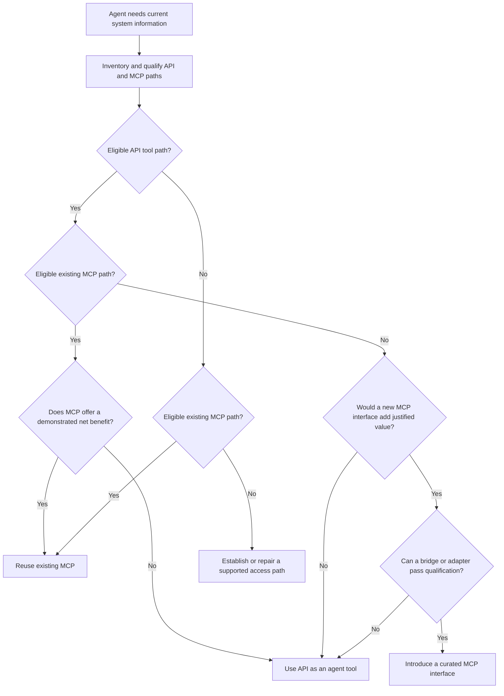

# Agent access to external systems: API or MCP?

Use this decision tree when an agent needs current information from a system outside its runtime. The source may be an internal application or a third-party service. For communication with another agent, use the separate [agent interaction decision tree](agent-interaction-decision-tree.md).

**Existing APIs are valid agent tools. Build or adopt MCP when its interoperability, reuse or management value justifies the implementation and operating cost. An available MCP server is a candidate, not an automatic winner.**

This is project architecture guidance, not a protocol requirement. Read the [comparison guide](api-vs-mcp.md) for the rationale. Detailed approval processes remain in [governance](governance.md) and [governed actions](governed-actions.md).

## Define the requirement and qualify candidates

Record the required operations, fields, users, source freshness, consistency, response deadline, volume and data destinations. Inventory both API and MCP options, including supported platform connectors. Evaluate each complete runtime path against these gates before entering the tree.

| Eligibility gate | Evidence needed for either path |
| --- | --- |
| Functional fit | Required operations, filters, pagination, errors and result detail are supported |
| Freshness | Source age and consistency meet the requirement; retrieval time alone is insufficient |
| Identity and authorization | Approved identity flow preserves tenant, record and field permissions; scopes are sufficiently narrow |
| Data boundary | Credentials, returned data, model inputs, logs and retention remain within approved boundaries |
| Governance | Required enforcement, approval, audit, revocation and ownership exist on the actual route |
| Runtime compatibility | The client, connector, transport, authentication and network path work together |
| Service objectives | Measured latency, availability, throughput, rate limits and cost meet the workload |
| Support | Named owner, version policy, incident response and maintenance arrangements exist |

An interface can exist without being eligible. A failed security or freshness gate cannot be offset by convenience or a lower cost score. A proposed implementation is provisional until qualification evidence exists.

## Decision tree

In this diagram, an eligible API means an API **plus a supported agent-tool integration** that meets the gates above. An eligible MCP option means the complete client-to-server-to-source route meets them.

### How to answer the benefit questions

A demonstrated MCP benefit can be reduced duplicated integration across compatible clients, easier approved tool discovery and lifecycle management, or reuse of a supported vendor integration. Compare these benefits with server ownership, authentication complexity, extra dependencies and operating costs. Multiple agents alone do not require MCP; a shared SDK, OpenAPI contract or platform connector may already provide sufficient reuse.

When both paths qualify and no material MCP benefit is established, prefer the simpler supported path, normally the existing API integration. If enterprise policy mandates a particular route, record the policy constraint explicitly.

When introducing MCP, use a gateway bridge if selected API operations map cleanly. Use a custom adapter when composition, output shaping or identity mediation needs implementation. A separate custom server deployment is not always necessary. Keep business authorization and transaction rules in the authoritative service.

If the API exists but cannot be consumed directly by the agent platform, an MCP bridge may establish an eligible route. Likewise, an adapter can address a contract mismatch. Re-enter qualification after addressing the gap; do not treat a wrapper as a waiver for inaccessible data or missing permissions.

## Availability scenarios

| Available interfaces | Decision |
| --- | --- |
| API only | Use it as a tool when qualified. Introduce MCP only for an identified interoperability, reuse, platform or management need |
| API and MCP | Qualify both independently, then compare total value. API access may retain better coverage, identity support or performance |
| MCP only | Reuse it if qualified; a separate API integration is unnecessary |
| Neither, or neither qualifies | Establish or repair supported access, then reassess. If no compliant path meets the requirement, use a manual process or revise the requirement |

The decision applies per capability. One agent can use MCP for one operation and an API tool for another, with explicit ownership and controls for both. Do not automatically switch paths during failures if that would bypass policy or change authorization semantics.

## Worked travel-system examples

These examples use a Concur-like travel and expense system. MCP availability, permissions and endpoint coverage are hypothetical; verify the actual vendor offering and tenant configuration.

| Requirement and context | Outcome | Reason |
| --- | --- | --- |
| One agent retrieves an employee's upcoming travel through an approved API connector | API tool | Narrow existing integration satisfies the requirement |
| Several compatible agent platforms duplicate the same travel tools and maintenance | Evaluate shared MCP | A curated interface may reduce repeated work; compare against a shared SDK |
| Approved vendor MCP covers the travel lookup and preserves user permissions | Reuse MCP when beneficial | Supported integration can reduce maintenance |
| Vendor MCP lacks the required expense detail or demands excessive scopes | API tool if qualified | MCP availability does not override coverage or least privilege |
| Both cover the same operation, but only the measured API path meets the response deadline | API tool | The service objective determines eligibility |
| APIs exist but the consuming platform only permits approved MCP connectors | Introduce or reuse qualified MCP | Platform constraints provide a concrete reason for the interface |
| MCP is the only supported integration and meets the requirements | Reuse MCP | No reason to introduce a second interface |
| Only a nightly export is available, but the agent requires current booking status | Requirement unmet | Neither a tool wrapper nor MCP can make the export current |

## When no suitable interface exists

1. Investigate supported connectors, SDKs, event feeds, reports and exports. Verify their permissions, licensing and actual freshness. An SDK often uses an underlying API.
2. For an owned application, establish a supported backend integration. A controlled service or approved database/read-replica query may be suitable when it preserves business access rules and source consistency.
3. Consider authorized browser automation or RPA when supported interfaces cannot meet the need. Evaluate credential isolation, data exposure, UI fragility, failure detection and operational ownership.
4. Expose the chosen integration through an API tool or MCP according to the same criteria.
5. If no approved access method meets the requirement, return an explicit limitation and route to a manual process or revise the requirement.

MCP defines an interface to a capability. It does not create a missing integration or grant access to restricted data.

## Freshness and performance

Specify maximum source age, required consistency and response deadline separately. Return source update or observation time where available, retrieval time, cache age, provenance and completeness. A recent retrieval can contain old source data. Partition caches by entitlement and recheck access where necessary.

For continuous updates, consider an event-backed service or supported subscription. A tool can query that service; repeated polling is not automatically the right design. Cross-system results should disclose differing observation times and incomplete snapshots.

Measure equivalent tasks under equivalent authorization and policy controls. Include p95/p99 latency, throughput, source calls, tool calls, payload size, model context, retries, availability and cost per successful task. MCP does not inherently require server-side inference. A remote deployment can add hops; a well-designed composite operation can reduce total interactions through either interface.

## Record the outcome

Capture the chosen route per capability, alternatives considered, disqualified options and reasons, identity and data boundary, evidence for freshness and performance, accountable owner, operational cost and review triggers. Revisit the decision when consumers, contracts, vendor offerings or controls materially change.

[Why and when MCP adds value](api-vs-mcp.md) · [Agent interaction decision tree](agent-interaction-decision-tree.md) · [Research](research-and-sources.md)
