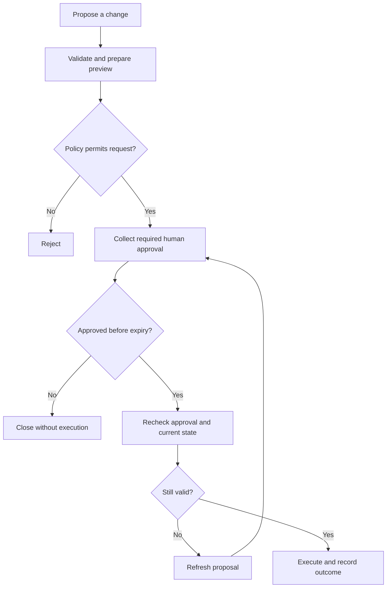

# Governing consequential actions

This proposed operating model covers create, update, delete and other consequential operations exposed to agents. It can also apply to sensitive reads or external data disclosure.

The risk review produces a reusable action policy. Each execution then applies that policy to the requester, arguments, target records and current business state.

## Risk and human oversight

Consider impact, reversibility, volume, data sensitivity, external commitments and downstream automation. Creating a financial commitment may be more consequential than deleting a temporary draft.

| Category | Proposed oversight |
| --- | --- |
| Reversible and narrowly scoped change | Requester confirms the concrete change |
| Material operational consequence | Designated business approver |
| Irreversible, bulk or highly sensitive change | Independent approval and additional reviewers where business controls require them |
| Outside permitted boundaries | Denial or an established manual process |

These are starting patterns for enterprise review. The business owner sets thresholds and eligible approvers. A change in scope or risk triggers reassessment.

Separate onboarding approval, per-execution authorization, requester intent confirmation and independent business approval. A requester may be authorized to propose a change while another person must authorize its execution.

## Runtime workflow

### Prepare

Resolve record identifiers and calculate the change through trusted application logic. Present the environment, target records, before-and-after values, record count, downstream effects and recovery options. For bulk changes, bind approval to the concrete set or an explicitly bounded snapshot.

Keep the proposal durable so approval survives a closed chat or restarted agent. An agent may explain its reasoning, while the authoritative preview comes from validated application data.

### Approve

Use authenticated approval channels and eligible business approvers. Apply separation of duties where required. Reuse existing application approval workflows when they cover the intended operation.

Persist requester, approver, action and version, environment, canonical arguments, targets, policy version, expiry and relevant record versions. Protect the record from modification by the agent.

Reference it using an opaque identifier or a signed authorization whose integrity and issuer can be verified. A prompt assertion or model-supplied approval boolean cannot authorize execution.

### Verify and execute

Recheck current authorization, approval expiry and revocation, arguments, target scope and domain preconditions immediately before execution. Use a domain transaction or conditional update to close the race between checking record state and changing it.

A material change invalidates the proposal and requires renewed approval. Approval grants authority only for its defined operation.

Associate the approval with one logical transaction. Atomically claim execution where possible and coordinate it with durable idempotency state. A single-use marker alone cannot solve the crash window between a downstream write and recording success.

For remote services, use their idempotency or conditional-write facilities where available. If the result is uncertain, reconcile the actual state before retrying. Retain per-item outcomes for partial bulk failures and define whether continuation needs new approval.

### Record and recover

Record the verified proposal, decision, policy version, execution identity, actual outcome and correlation identifiers. Minimize sensitive log payloads and apply retention controls.

Define compensation or correction procedures for partial failure. Compensation may itself require authorization. Restrict subsequent agent behavior to the approved scope.

## Control placement

| Component | Responsibility |
| --- | --- |
| MCP gateway | Enterprise identity, tool access, approved routing, limits and disablement |
| Approval workflow | Reviewer eligibility, separation of duties, expiry, escalation and durable decisions |
| Adapter or action service | Preview, approval binding, verification and execution coordination |
| Domain API | Object permissions, business preconditions, concurrency and duplicate protection |
| Agent runtime | User experience, pause/resume and outcome presentation |

A gateway can validate approval evidence if its extension points support the required checks. An adapter or action service can supply that function when necessary. The domain service still enforces its own entitlements.

For vendor-hosted MCP, assess native vendor approvals and their guarantees. Otherwise, mediate governed writes through a controlled service. Restrict alternative paths and credentials. If required guarantees cannot be achieved, keep the action outside agent execution.

## Illustrative action

An order-management assistant proposes changing an eligible order's delivery date.

The preview identifies the order and original date, proposed date, current version and any consequential notifications. The approved policy determines whether requester confirmation or supervisor authorization is required. At execution, the service checks the order remains eligible and its version matches the proposal. A conflicting update returns the proposal for review.

All identifiers, thresholds and business rules in implementation examples should be synthetic.

## Streamlining oversight

- Maintain a small catalog of reusable approval patterns.
- Reuse existing business approval workflows and their evidence.
- Review material changes against the previously approved policy.
- Approve a bounded business transaction with explicit effects across internal calls.
- Track approval delay, correction rate, stale approvals, failures, prevented duplicates and unauthorized execution attempts.

Pilot a reversible update with a small scope and an existing business approver. Test changed arguments, expired or revoked approval, changed records, unauthorized reviewers, retries, partial failure and direct-call bypass.

The [action policy template](../templates/action-policy.md) captures the implementation contract. [Industry research](research-and-sources.md) distinguishes provider features from this proposed design.
