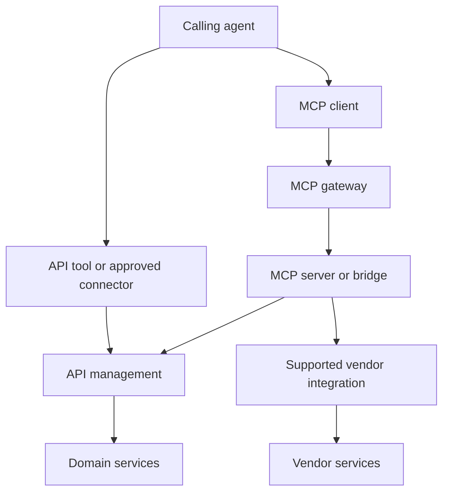
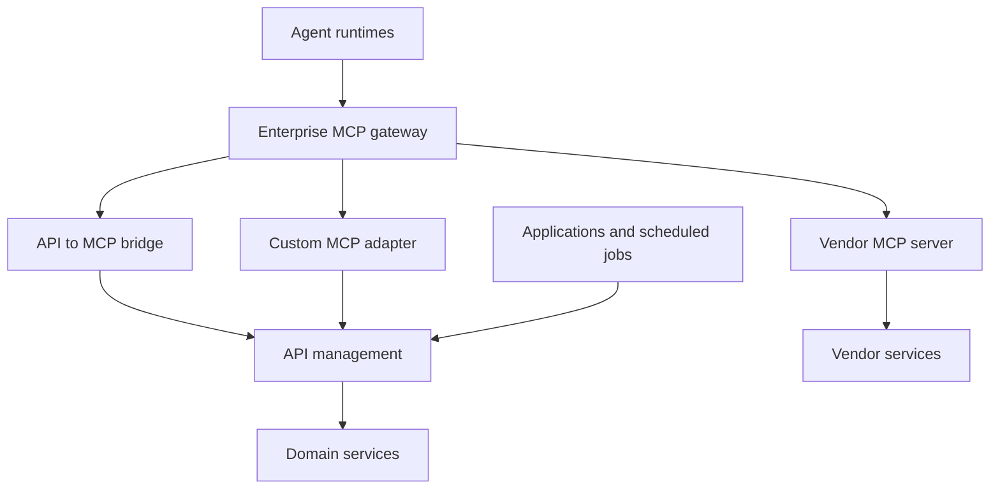

# Enterprise reference architecture

This design assigns responsibilities to components that organizations can map to their existing infrastructure.

## Agent access paths

Start with the [system access decision](decision-tree.md). An agent can use existing managed APIs as tools or consume a qualified MCP interface. MCP often uses those same APIs downstream. Select per capability using functional fit, identity, governance, source freshness, measured performance and total ownership cost.

These are logical alternatives. A gateway product may combine functions, and a vendor MCP service may own its downstream API route. Preserve mandatory enforcement without unnecessary duplicate hops.

API tools remain subject to approved API and agent-runtime controls. All MCP routes use the required MCP enforcement path. An approved API tool is not a bypass; an unapproved alternative route is.

For a provider that is another agent, use the separate [agent interaction decision tree](agent-interaction-decision-tree.md). API, MCP, framework-native invocation and A2A are candidates according to the required interaction contract. The receiving agent independently chooses its source-access interfaces.

Define source age, consistency and response deadlines separately. For an agent result, preserve source observations separately from the time the agent generated its answer.

## MCP runtime paths

The MCP gateway enforces enterprise access policy and records activity across registered routes. API management continues to govern service APIs. Where one product supplies both functions, define the logical policy ownership and avoid accidental duplicate routing or inconsistent limits.

The registry holds approved endpoints and ownership metadata. Runtime enforcement must use trusted configuration. Registration alone does not prove that a route is secure.

## Deployment patterns

| Pattern | Use | Required validation |
| --- | --- | --- |
| Bridge over existing APIs | Selected operations map cleanly | Schema mapping, identity, error semantics and supported primitives |
| Custom adapter on a container platform | Composition or transformation is needed | Workload identity, secrets, patching, health, rollback and downstream controls |
| Vendor package hosted by the enterprise | Vendor supports self-hosting | Licensing, support, upgrades and isolation |
| Vendor-hosted MCP through an egress gateway | Provider operates the service | Tenant isolation, OAuth compatibility, data handling and vendor change control |
| Native platform tool over API | Existing API integration or shared connector meets the requirement | Equivalent authorization and governed-action enforcement |

OAuth discovery, redirect behavior and resource audiences must work through the actual gateway consumer URL. Obtain downstream credentials through an approved flow with the proper audience and scope. Verify token handling against the authorization specification applicable to the deployment.

Restrict direct ingress and alternative credentials that would bypass required controls. For managed agent platforms, validate private connectivity, connector restrictions and vendor-direct routes with the platform owner.

## Tool contract

A proposed tool review should capture the following.

- A stable name and concise task description, including when to use it.
- Input schema with explicit required fields, bounds and enumerations where useful.
- Structured output and an output schema where supported.
- Stable error categories with actionable recovery guidance.
- Pagination, truncation and authorized artifact retrieval for large results.
- Actual side effects, retry behavior, approval requirements and data classification.
- Downstream API dependencies and versions.

Treat tool descriptions and results as untrusted content at the agent boundary. Use approved catalog entries to control exposure and review unexpected tool-set changes. Verify authorization for both discovery and invocation.

The business service owns object permissions and state transitions. An adapter should preserve these semantics while presenting a useful agent interface.

## Platform qualification

For every candidate platform, record remote MCP consumption and publishing support separately. Also record transport, authentication, supported primitives, approval hooks, private routes, tool filtering and durable pause/resume behavior.

Commercial products can implement different subsets. Public examples include Google ADK MCP tools, UnifyApps MCP consumption and publishing, and Palantir's external Ontology MCP exposure. Test the exact deployed configuration before claiming interoperability.

## Gateway migration

Preserve the published tool contract while changing backend routes. Recheck identity, quotas, error mapping, approval enforcement and trace propagation. Record the active route by environment and maintain a rollback plan.

[Industry evidence](research-and-sources.md) · [Governance](governance.md).
